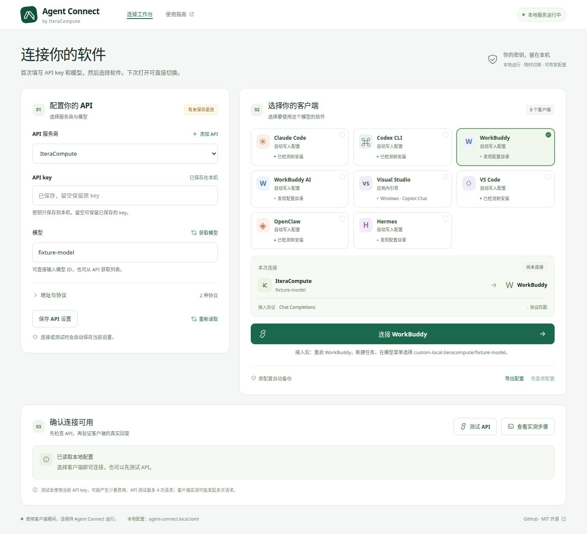
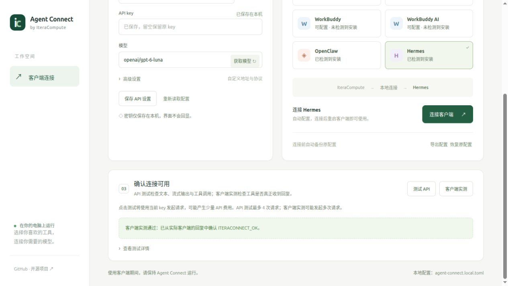

# Agent Connect

**Choose an API → Choose a client → Connect.**

[**中文**](README.md) | [**English**](README.en.md)

A lightweight local connector for Claude Code, Codex, WorkBuddy, WorkBuddy AI, Visual Studio, VS Code, OpenClaw and Hermes.
IteraCompute is configured by default; you can save and switch to other compatible model APIs.
The UI, configuration editors and relay are independent implementations. No CC Switch or Magpie
application source is copied. The normal workflow requires **Python 3.11+** only: no pip install,
Node.js, CC Switch or Magpie installation is needed.



This README and the Chinese version contain the same complete workflow. The application UI
currently uses Chinese labels; the button reference below lets you follow this English guide.

**Contents:** [Quick start](#quick-start) · [Key file](#fill-the-configuration-file) · [Other APIs](#connect-other-apis) · [Clients](#connect-each-client) · [Verification](#verify-the-connection) · [Restore](#switch-and-restore-settings) · [Troubleshooting](#troubleshooting) · [Contributing](#development-and-governance)

## Quick start

### 1. Prepare your environment

- Install **Python 3.11 or newer** and make sure your terminal can run it.
- Install the client you want to connect. You can write configuration before installation,
  but successful configuration is not evidence of a real inference response.
- Obtain an API key with access to your intended model. Verification can incur API usage.

Check your Python version:

```bash
# macOS / Linux
python3 --version
```

```powershell
# Windows PowerShell
py -3 --version
```

If Windows has no `py` launcher, use `python --version` and `python start.py`, provided that
`python` is version 3.11 or newer.

### 2. Download and launch

The initial implementation was merged into the default `main` branch in [PR #1](https://github.com/IteraCompute/agent-connect/pull/1). Download and launch it:

```bash
git clone https://github.com/IteraCompute/agent-connect.git
cd agent-connect
python3 start.py
```

On Windows, replace the last line with `py -3 start.py`. Without Git, download the
[`main` branch ZIP](https://github.com/IteraCompute/agent-connect/archive/refs/heads/main.zip),
extract it, and open the directory containing `start.py`.

| Platform | Recommended launch | Alternative |
| --- | --- | --- |
| Windows | `py -3 start.py` in the project directory | Double-click `Start.bat` |
| macOS | `python3 start.py` in the project directory | Double-click `Start.command`; use the terminal if execution is blocked |
| Linux | `python3 start.py` in the project directory | Your own terminal launcher |

The launcher opens the local workspace and creates `agent-connect.local.toml` in the project
directory on first use. If the browser does not open, copy the **complete URL** printed in the
terminal, including the local management token after `#`. Opening only `http://127.0.0.1:18424/`
in a new browser session may not authorize management operations.

### 3. Enter an API key and model

1. Keep **IteraCompute** selected and enter your key in **API key**.
2. The default model is `openai/gpt-6-luna`, which passed the recorded acceptance checks.
   Click **获取模型** (Fetch models) to choose another, or type its complete model ID.
3. Click **保存 API 设置** (Save API settings), or let connection, export or verification save
   the form automatically.

Fetching models requests the catalog only. It does not generate a response, save the draft or
replace the live relay credentials. Availability depends on your account and the current API;
see the dated [acceptance record](docs/acceptance.md).

### 4. Select and connect a client

1. Select a client card, such as **Claude Code**.
2. Check the API, model and protocol in the connection preview. Once it shows **协议匹配**
   (Protocol matched), click **连接 Claude Code** (Connect Claude Code), or the equivalent
   button for your selected client.
3. For cards labeled 自动写入配置 (automatic configuration), Agent Connect backs up the original file and writes that client's user configuration.
   Fully quit and restart the client, then create a fresh session.
4. Visual Studio opens a setup guide for its model manager. VS Code requires selecting the added model after reload. WorkBuddy / WorkBuddy AI requires choosing the added `custom-local` model in the
   task model menu; see [client instructions](#connect-each-client).

Keep Agent Connect's launcher terminal running while using a connected client. Closing the
browser tab does not stop the service; press `Ctrl+C` in its terminal to stop it. Run the same
launch command next time to reload saved settings. Restarting Agent Connect alone, with the
same endpoint and model, does not require entering the key again.

### UI button reference

| Chinese label | Meaning |
| --- | --- |
| 添加 API / 取消添加 | Add API / Cancel adding |
| 获取模型 | Fetch models |
| 地址与协议 | URL and protocols |
| 保存 API 设置 | Save API settings |
| 重新读取 | Reload the private configuration file |
| 连接 + client name | Back up and configure the selected client |
| 测试 API | Test the selected client's API protocol |
| 客户端实测 | Run an isolated actual-client test |
| 导出配置 / 复制配置 | Export / Copy a manual configuration fragment |
| 恢复原配置 | Restore the configuration from before the first connection |
| 检查协议 | Open the protocol setting required by this client |

## Fill the configuration file

You can enter the key entirely through a file. Launch once, then edit the generated
`agent-connect.local.toml`:

```toml
selected_provider = "iteracompute"
client = "claude"

[providers.iteracompute]
name = "IteraCompute"
api_key = "" # Enter your key between the quotes
base_url = "https://api.iteracompute.com"
model = "openai/gpt-6-luna"
protocols = ["chat", "responses", "anthropic"]
```

This is a complete example. Normally only `api_key` needs changing. Save, then click
**重新读取** (Reload); if the service is not running, simply start it. You can also use the blank
[config.example.toml](config.example.toml), but do not overwrite a local file already containing a key.

| Field | Purpose |
| --- | --- |
| `selected_provider` | API ID for this operation; must match a `[providers.<id>]` table |
| `client` | `claude`, `codex`, `workbuddy`, `workbuddy-ai`, `visual-studio`, `vscode`, `openclaw` or `hermes` |
| `name` | Display name |
| `api_key` | This provider's credential; never returned to the page or written to client settings |
| `base_url` | API root or OpenAI-compatible `/v1` base |
| `model` | Complete model ID, including provider-supplied `/` characters |
| `protocols` | Native protocols the API actually serves; checking a box does not add server capabilities |

The file is ignored by Git and uses owner-only read/write permissions on POSIX. On Windows,
keep it in your own user directory. Stored keys are not shown in the UI; leaving its key input
empty preserves the saved value. To remove a key, set `api_key = ""` in the file and reload.
The simple app uses this file exclusively, not other vendor credentials inherited from your shell.
Do not publish filled key files, management URLs or exported relay credentials in issues, PRs
or screenshots.

If the UI says the local file changed, click **重新读取** before saving. The app stops the stale
save rather than overwrite a key you just entered outside the page.

## Connect other APIs

### Add through the workspace

1. Click **添加 API** (Add API).
2. Enter a unique ID such as `my-api`. It must start with a lowercase letter and contain only
   lowercase letters, digits and hyphens, with at most 48 characters.
3. Enter a display name and this API's key. Set its base URL under **地址与协议**.
4. Select the protocols the API **actually supports**. Fetch models or enter a model ID directly.
5. Choose a client and connect, or save the API for later selection in the provider menu.

A new provider starts with an empty key and never inherits another provider's credential.
**取消添加** discards the new draft and restores the previous provider form. If the vendor does
not implement a model catalog, type the model ID it documents instead.

### Choose the URL and protocols

| API type | Example base | Protocol | Directly supported clients |
| --- | --- | --- | --- |
| OpenAI Chat compatible | `https://api.example.com/v1` | `chat` | WorkBuddy, WorkBuddy AI, VS Code, Visual Studio, OpenClaw, Hermes |
| OpenAI Responses compatible | `https://api.example.com/v1` | `responses` | Codex CLI, VS Code |
| Anthropic Messages compatible | `https://api.example.com` | `anthropic` | Claude Code |
| Multiple native protocols | Vendor's documented base | Only protocols it actually serves | Clients requiring those protocols |
| Local OpenAI-compatible server | `http://127.0.0.1:PORT/v1` | As supported by the server | Clients requiring those protocols |

Enter a **base**, not a full inference route ending in `/chat/completions`, `/responses` or
`/v1/messages`. Public endpoints require HTTPS; loopback endpoints may use HTTP. A keyless local
server still needs a nonempty placeholder key such as `local` in Agent Connect.

If protocols use different paths, append explicit endpoints after an existing provider table:

```toml
[providers.my-api.endpoints]
chat = "https://api.example.com/openai/v1"
responses = "https://api.example.com/openai/v1"
anthropic = "https://api.example.com/anthropic"
```

This assumes `[providers.my-api]` already exists and advertises these protocols. See
[configuration](docs/configuration.md) for complete rules.

The local relay preserves native protocols. It does not convert Chat to Responses or Messages.
A Chat-only service cannot directly serve Claude Code or Codex through the simple app; use the
[optional Magpie bridge](docs/advanced.md) when conversion is required.

Configuration also accepts Gemini endpoints, but the eight client entries use Chat, Responses
or Messages. See the [coverage matrix](docs/coverage.md) for Gemini-specific advanced access.

## Connect each client

Choose an automatic configuration card or guided setup for Visual Studio. No additional vendor key needs
to be entered in the client: it receives a local relay credential, and Agent Connect forwards requests.

| Client | Required native protocol | Configuration location |
| --- | --- | --- |
| Claude Code | Anthropic Messages | `~/.claude/settings.json` |
| Codex CLI | OpenAI Responses | `~/.codex/config.toml` |
| WorkBuddy | OpenAI Chat Completions | `~/.workbuddy/models.json` |
| WorkBuddy AI | OpenAI Chat Completions | `~/.workbuddy-ai/models.json` |
| Visual Studio (Windows) | OpenAI Chat Completions | Copilot Chat → Manage Models → Add a model |
| VS Code (stable desktop) | OpenAI Responses preferred, or Chat Completions | User profile’s `chatLanguageModels.json` |
| OpenClaw | OpenAI Chat Completions | `~/.openclaw/openclaw.json` |
| Hermes | OpenAI Chat Completions | `~/.hermes/config.yaml` |

`~` means the current user's home, typically `C:\Users\YOUR_NAME` on Windows. Client-specific
configuration environment variables change these paths; see [file locations](#file-locations-and-startup-options).

### Claude Code

Select **Claude Code**, connect, exit the old process and start a fresh `claude` session in a
new terminal. The adapter sets the Messages endpoint, model and local authentication while
preserving unrelated settings. Project settings, environment variables or enterprise policy
can still override user settings. Verify with the workspace's actual-client test or send the
fixed test message below in a new session.

### Codex

Select **Codex CLI**, connect and restart `codex`. The adapter sets a Responses provider named
`iteraconnect` and your selected model. If an existing user file already contains an unrelated
provider with that name, the app reports an error and preserves the file. Rename that entry
before retrying or export and merge the fragment manually. Acceptance covers Codex CLI;
those results are not evidence for other desktop, IDE or cloud execution modes.

### WorkBuddy / WorkBuddy AI

Choose the card matching your installed edition, connect, restart the application and create
a new task. Select `custom-local:iteracompute/MODEL_ID` in the task model menu; replace
`iteracompute` with your API ID for other providers. The display name includes
`Agent Connect · MODEL_ID`. Existing models are preserved; the added model's `vendor` is `iteraconnect`.

The workspace requests manual verification in the original application. Automated desktop
inference acceptance is not available; successful configuration alone is not a passing inference test.

### Visual Studio (Windows)

Select **获取 Visual Studio 接入信息**. In Visual Studio 2026 18.10 or later, open the Copilot Chat model picker and select Manage Models. Add a Custom Endpoint, or an OpenAI provider that accepts a custom URL. Use the Completions format and the three copy buttons for the endpoint URL, model ID and local relay key. Select that model in a new Agent chat. Remove the endpoint from the same menu to disconnect. [Microsoft model management guide](https://learn.microsoft.com/en-us/visualstudio/ide/copilot-select-add-models?view=visualstudio)

### VS Code

Run Agent Connect on the same machine as stable desktop VS Code with the Copilot Chat Custom Endpoint provider. The workbench prefers Responses when advertised and uses Chat Completions for Chat-only APIs. Select **连接 VS Code**, reload the window and select the model under Agent Connect in a new local chat. The adapter targets the default profile. For a named or portable profile, set `ITERACONNECT_VSCODE_USER_DIR` to the directory containing that profile’s `chatLanguageModels.json` before launching the workbench. [VS Code model configuration](https://code.visualstudio.com/docs/agent-customization/language-models)

### OpenClaw

Select **OpenClaw**, connect, restart its relevant processes using your normal launch method
and begin a fresh session. The adapter updates the provider and default model, extending an
existing model allowlist to include the connected model. It does not enable channel delivery.
The workspace test runs a local single turn with independent temporary settings and no daily sessions.

### Hermes

Select **Hermes**, connect, restart Hermes and create a new session. The adapter uses the
`custom:iteraconnect` provider with explicit Chat transport, preserving unrelated settings.
Automatic actual-client testing uses Hermes 0.23.1 JSONL output; older versions can be checked
manually in the original client. Complex YAML is rejected without rewriting the original;
use an exported fragment or the advanced adapter instead.

## Verify the connection

Testing is optional before connecting: you may test the API first. **Tests never run automatically
at startup.**

| Operation | What it verifies | Usage and limits |
| --- | --- | --- |
| **获取模型** | Vendor model catalog | One catalog request; no generation or draft save |
| **测试 API** | Text, complete SSE and a tool-call/result round trip for the selected client's protocol | Up to 4 generation requests, each with a 256-token output budget |
| **客户端实测** | Installed Claude Code / Codex / OpenClaw / Hermes process and its actual reply | Uses API quota; temporary settings/directories; no daily logins or chats copied |
| **查看实测步骤** (WorkBuddy editions, VS Code, Visual Studio) | Message and tool task inside the original application | Manual acceptance required and explicitly reported |

Recommended sequence:

1. Choose the API, model and client. Click **测试 API** and check that all three result cards pass.
2. For an installed client supporting automation, click **客户端实测**.
3. Connect, restart the original client and send this in a new session:

   ```text
   Reply with exactly ITERACONNECT_OK.
   ```

4. In a disposable test directory, ask the client to create and read a small file to verify
   its actual tool workflow.

The API tool test returns a fixed string; it never executes model-generated commands. A passing
native single turn does not establish the client's full tool loop, long sessions, vision,
permissions or error recovery.



This result-card screenshot uses a **local simulated backend** to demonstrate the UI. Real
IteraCompute acceptance was recorded on 2026-11-16: the three native protocols and four actual
CLIs passed the listed checks with `openai/gpt-6-luna`. WorkBuddy desktop inference still awaits
manual acceptance. Earlier Auto 400/429 and a Haiku tool 502 are retained in the
[acceptance record](docs/acceptance.md), separately from simulated results.

[GitHub CI](https://github.com/IteraCompute/agent-connect/actions/runs/44015209371) passed unit/fixture
tests on Ubuntu, macOS and Windows with Python 3.11/3.14, plus quality/build, Magpie and the required
aggregate check. Cross-platform CI does not replace real-client acceptance on each platform.

See the [2026-11-18 per-client acceptance results and reproduction steps](docs/client-setup-acceptance.md).

### Read the status labels

| Chinese status | Meaning |
| --- | --- |
| 有未保存更改 | API, model, protocol or client changed; connection, export and tests save automatically |
| 协议匹配 / 需要配置 | Checks declared protocol support only; a mismatch disables connection/tests and links to its setting |
| 已检测到安装 | The executable is on PATH. A configuration directory alone is labeled 发现配置目录 |
| 已配置 · 可恢复 | An original-config backup exists, not an inference result for this model |
| API 测试通过 | All three protocol checks passed; expand the redacted report for details |
| 客户端实测通过 | The expected reply was confirmed in a real client's output |

Changing the API, model or client clears old results. Client cards support Tab, arrow keys and
Home/End. Narrow screens use a stacked layout.

## Switch and restore settings

**Switch models or providers:** choose another API/model, keep the intended client selected,
connect again, then restart that client. Saving API settings alone does not edit client files.
Connecting one client does not automatically configure the others; connect each separately.

A connected client keeps the provider and model last written for it. Changing a saved provider's
key or base URL affects the local relay. Do not remove providers still used by clients. Restore
before switching configuration managers to avoid competing changes.

**Restore an automatically configured client:** select the client, click **恢复原配置**, then restart it. The first connection records
the original content, which remains the backup across reconnections. If the file did not exist
before connecting, restoration removes the file created by Agent Connect.

If another application edits the file after connection, automatic restoration stops to preserve
those later changes. Compare the backup under `native-backups` and merge manually; do not delete
the client's entire configuration directory. Standard JSON, Codex TOML and common indented
Hermes YAML/JSON are supported. JSON5 or complex structures are rejected with the original preserved.

**Manual export:** click **导出配置**, expand the fragment and click **复制配置**. Merge it into the
appropriate file yourself. Export does not edit the client or mark it connected. Fragments
include a local relay credential and should remain on your machine.

## File locations and startup options

| File / endpoint | Default | Purpose |
| --- | --- | --- |
| Private API settings | `agent-connect.local.toml` in the project | Provider keys, models and last selection |
| State directory | `~/.config/iteraconnect` | Local relay key and backups |
| Original configuration backups | `native-backups` in the state directory | Original content and conflict checks for each client |
| Management workspace | `127.0.0.1:18424` | Per-launch token and Host/Origin checks |
| Inference relay | `127.0.0.1:18423` | Local API used by connected clients |

`ITERACONNECT_HOME` overrides the state directory; otherwise it follows `XDG_CONFIG_HOME`.
Adapters honor `CLAUDE_CONFIG_DIR`, `CODEX_HOME`, `WORKBUDDY_CONFIG_DIR`, `WORKBUDDY_AI_CONFIG_DIR`,
`OPENCLAW_STATE_DIR` / `OPENCLAW_CONFIG_PATH`, and `HERMES_HOME`.

```bash
# Change ports; on Windows replace python3 with py -3
python3 start.py --port 18434 --relay-port 18433

# Do not open a browser; use the complete URL printed in the terminal
python3 start.py --no-browser

# Show startup options
python3 start.py --help
```

Reconnect clients after changing the relay port. Run only one instance with the same ports.
To store private settings elsewhere, run these from the source directory:

```bash
python3 -m pip install .
itera-connect app --settings /absolute/path/to/private.toml
```

`pip install .` installs this checkout; it does not imply a published PyPI release. The simple
app's TOML and advanced CLI's JSON are independent configurations. To update a checkout, run
`git pull --ff-only` in the project, then restart Agent Connect. Preserve the ignored local TOML.

## Troubleshooting

| Symptom | Check / action |
| --- | --- |
| Missing `python3` / `py`, or unsupported version | Install Python 3.11+ and reopen the terminal; on Windows check `python --version` |
| Missing `start.py` | Download the default `main` branch and enter the extracted/cloned directory containing the file |
| Page unavailable / port occupied | Stop the old instance or change both ports; use the full terminal URL if the browser did not open |
| Management page is unauthorized | Use the URL from this launch; the management token changes after restarting the service |
| API 401 / 403 | Check key, account and model access; reload after editing the private file |
| 429 / 502 / timeout | Inspect redacted details; retry later or choose another authorized model; an explicit model is usually easier to diagnose than Auto |
| Model catalog fails | Check the base URL; the vendor may not expose a catalog, so type its documented model ID |
| Disabled connection / test buttons | Check the selected client's required protocol; do not declare support merely to enable a button |
| Configuration succeeded but old model remains | Quit old processes and start a new session; inspect project/environment/policy overrides and WorkBuddy's task model selection |
| Installed client reported missing | Check command visibility in the terminal launching Agent Connect and the actual config directory; connect first and test manually if needed |
| Cannot save after editing the file | Reload first to preserve external changes |
| Restore refused / JSON5 or YAML rejected | Original remains; compare backups and merge manually, or use the advanced adapter |
| Client cannot connect after closing workspace | Keep the launcher terminal running; restart Agent Connect if it was stopped |

Raw vendor error bodies and arbitrary client logs are not returned directly, to avoid exposing
credentials or private context. The workspace serves this machine only. Remote sharing,
conversion and broader upstream settings are covered in the [advanced guide](docs/advanced.md).

## Development and governance

```bash
python3 -m venv .venv
source .venv/bin/activate
# Windows PowerShell: .venv\Scripts\Activate.ps1
python -m pip install -e . -r requirements-dev.txt
python -m unittest discover -v
ruff check .
ruff format --check .
python -m build
```

Only the Python standard library is needed at runtime. Ruff and build above are development
dependencies. UI source is in `src/iteraconnect/web`, independent adapters in `native.py`, and
the relay in `gateway.py`. The [testing guide](docs/testing.md) distinguishes simulated vendor,
installed CLI and actual API evidence, including optional commands.

MIT licensed. [Issues](https://github.com/IteraCompute/agent-connect/issues),
[Discussions](https://github.com/IteraCompute/agent-connect/discussions) and PRs are welcome.
Share versions, protocol, model ID and a redacted reproduction. Community contributions are
open; merges require administrator review. Main's review/CI policy, first CODEOWNERS setup
and repair status are recorded in [governance](docs/governance.md).

For Magpie conversion, more clients, subscription logins, MCP, skills or CC Switch import, see
the [advanced entry points](docs/advanced.md) and [coverage matrix](docs/coverage.md). Optional
upstream versions, provenance and licenses are in [THIRD_PARTY_NOTICES](THIRD_PARTY_NOTICES)
and the lock file; those components follow their own credential/storage behavior.
