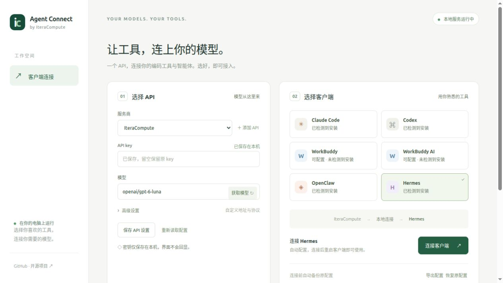

# Agent Connect

**选择 API → 选择客户端 → 点击连接。**

一个轻量的本地客户端，让 Claude Code、Codex、WorkBuddy、OpenClaw 和 Hermes 使用你选择的模型 API。
默认 IteraCompute，也可以添加其他兼容 API。独立实现界面、配置管理和本地转发，运行时只有 Python 标准库；
默认流程无需安装 CC Switch 或 Magpie，没有复制它们的应用代码。

[English](README.en.md) · [配置说明](docs/configuration.md) · [测试状态](docs/acceptance.md) · [高级接入](docs/advanced.md) · [参与贡献](CONTRIBUTING.md)



## 三步开始

需要 **Python 3.11+**，以及你要使用的客户端。开发版尚在管理员审核中，先使用功能分支：

```bash
git clone --branch feat/agent-connect https://github.com/IteraCompute/agent-connect.git
cd agent-connect
python3 start.py
```

Windows 用 `py -3 start.py`，或双击 `Start.bat`；macOS 可双击 `Start.command`。
启动器会打开浏览器中的本地界面，**不需要 pip install、Node.js 或额外的桌面应用**。
下载 ZIP 时也请选择 `feat/agent-connect` 分支；合并后可从 `main` 使用。

1. **填写 key**：默认已选 IteraCompute，填入 key，模型预选实测通过的 `openai/gpt-6-luna`；也可点击“获取模型”切换。
2. **选择客户端**：点击 Claude Code、Codex、WorkBuddy、WorkBuddy AI、OpenClaw 或 Hermes。
3. **点击“连接客户端”**：自动备份并写入配置。重启对应客户端即可使用；WorkBuddy 需要在任务模型菜单中选择 `custom-local:iteracompute/模型名`。

连接前不需要测试。要验证可用性，可点击“测试 API”或“客户端实测”。使用期间保持 Agent Connect 的启动窗口运行。
关闭浏览器标签页不会停止本地服务；终端按 `Ctrl+C` 停止。下次运行 `python3 start.py` 即可继续使用。

## 也可以只填一个配置文件

首次启动会在项目目录生成 **`agent-connect.local.toml`**，可参照 [config.example.toml](config.example.toml)。
只填写这一行即可，其他值保持默认：

```toml
[providers.iteracompute]
api_key = "在这里填写你的测试 key"
```

上面是需要修改的段落，完整配置请使用生成的文件。保存后在界面点击“重新读取配置”，即可开始测试。
也可以提前复制模板：

```bash
cp config.example.toml agent-connect.local.toml
python3 start.py
```

文件在本机以私密权限保存，已被 `.gitignore` 排除。**不要把填过 key 的文件发到 Issue、PR 或聊天中。**
界面不回显 key；输入框留空表示保留已保存的 key。要清空 key，在本地文件中改为 `api_key = ""` 后重新读取。
本地界面始终使用这个文件中的 key，不会借用终端里已有的供应商 key。

## 换其他 API

点击“添加 API”，填写名称、地址、key 和模型，再在高级设置中勾选服务实际支持的协议。保存后可随时切换。

| 客户端 | API 需要支持 | 连接后操作 |
| --- | --- | --- |
| Claude Code | Anthropic Messages | 重启 / 新开 Claude Code 会话 |
| Codex CLI | OpenAI Responses | 重启 / 新开 Codex 会话 |
| WorkBuddy / WorkBuddy AI | OpenAI Chat Completions | 重启应用，在任务中选择 custom-local 模型 |
| OpenClaw | OpenAI Chat Completions | 重启相关进程，新开会话 |
| Hermes | OpenAI Chat Completions | 重启 / 新开 Hermes 会话 |

IteraCompute 默认配置了 Chat、Responses、Messages 三种协议；具体模型是否支持工具、推理参数等，需要测试确认。
初次验收时 `Auto` 返回过 400/429，因此简化版预选了三个协议和三个客户端均实测通过的具体模型；仍可手动选择 `Auto`。
OpenAI 兼容地址可以填写 `https://example.com/v1`；不同协议使用不同路径时，见[自定义 endpoints](docs/configuration.md)。
本地 Ollama/vLLM 等服务可使用回环 HTTP 地址和任意非空占位 key（如 `local`）。

本地转发保留原生协议，不会把 Chat 自动转换成 Responses 或 Messages。
需要协议转换、订阅登录、更多客户端、MCP、skills 等功能时，可以使用保留的
[Magpie / CC Switch 高级入口](docs/advanced.md)；这些功能尚未全部重写进简化界面。

## 测试的含义

| 操作 | 检查内容 | 费用与限制 |
| --- | --- | --- |
| 获取模型 | 当前 API 的模型列表 | 一次模型目录请求，不做生成 |
| 测试 API | 所选客户端需要的协议：文本、SSE 完整结束、工具调用与结果回传 | 最多 4 次生成请求，每次输出预算 256 token |
| 客户端实测 | 临时独立配置中启动真实 Claude Code / Codex / OpenClaw / Hermes，检查实际回复 | 会产生 API 用量；不复制日常登录、聊天或插件配置 |
| WorkBuddy / WorkBuddy AI 实测 | 在原应用中发送测试消息和工具任务 | 界面会提示手动验证，配置写入不算通过 |

测试提示词为 `Reply with exactly ITERACONNECT_OK.`。API 工具测试只回传固定字符串，不执行模型生成的命令。
Hermes 自动测试基于 0.23.1 的 `stream-json` CLI；旧版请升级或手动验证。客户端单轮实测不能替代完整的工作流验收。当前证据及未完成项目见[验收记录](docs/acceptance.md)。

## 配置、备份与恢复

- **供应商密钥**只留在私密配置和转发进程中；客户端配置只获得本地网关令牌。
- 连接会修改所选客户端的用户配置并保留其他设置。第一次连接前自动备份原文件；点击“恢复原配置”可以还原。
- 如果客户端或其他工具后来改写了配置，自动恢复会停止，保护后续修改。可在配置目录的 `native-backups` 中手动核对。
- 支持标准 JSON、Codex TOML，以及 Hermes 常见的缩进 YAML / JSON。JSON5、复杂 YAML 或不兼容结构会明确报错并保留原文件；高级入口可处理更多格式。
- 管理界面只监听 `127.0.0.1:18424`，转发只监听 `127.0.0.1:18423`。管理操作需要启动时生成的令牌，并检查访问来源。

默认备份目录为 `~/.config/iteraconnect/native-backups`；设置 `XDG_CONFIG_HOME` 或 `ITERACONNECT_HOME` 时会跟随变更。
不要同时用多个配置管理器切换同一客户端。原有环境变量、项目级配置、企业策略可能覆盖用户配置；以客户端实测为准。

## 常见问题

**页面打不开 / 端口已占用**：先关闭旧的 Agent Connect。也可运行
`python3 start.py --port 18434 --relay-port 18433`；变更转发端口后需重新连接客户端。
浏览器没有自动打开时，复制终端显示的完整地址（含 `#` 后的本地管理令牌）。

**401 / 403**：检查 key、模型权限和账号状态。修改文件后点“重新读取配置”。
服务不会把供应商返回的原始错误正文显示到日志，避免泄露密钥。

**API 测试通过但工具仍不可用**：确认协议匹配，重新连接并重启客户端，检查项目级配置或环境变量覆盖。
工具调用还受模型能力、客户端版本及权限设置影响。

**想在另一台机器使用**：当前简化版只服务本机，不要公开管理端口。远程共享请参阅高级入口。

## 开发与开源治理

```bash
python3 -m venv .venv
source .venv/bin/activate
python -m pip install -e . -r requirements-dev.txt
python -m unittest discover -v
ruff check .
ruff format --check .
python -m build
```

[测试指南](docs/testing.md)包含真实 CLI + 模拟后端测试、真实 key 验收和各平台边界。
界面位于 `src/iteraconnect/web`，原生配置适配器位于 `native.py`，转发位于 `gateway.py`。

MIT 开源，欢迎 [Issues](https://github.com/IteraCompute/agent-connect/issues)、Discussions 和 PR。
`main` 要求管理员 CODEOWNER 审核、CI 检查及讨论解决，管理员同样受保护规则约束。实现通过 PR 提交，不自动合并。
当前组织 Actions 与首次 CODEOWNERS 审核设置仍需管理员处理，见[治理状态](docs/governance.md)。
上游可选组件的固定版本和许可证见 [THIRD_PARTY_NOTICES](THIRD_PARTY_NOTICES) 与锁文件。
